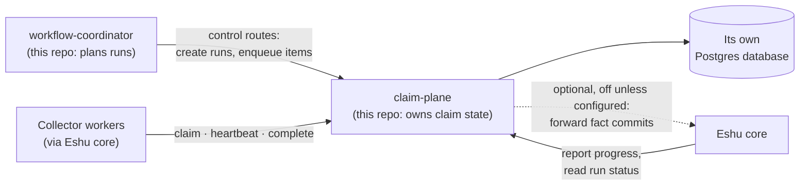
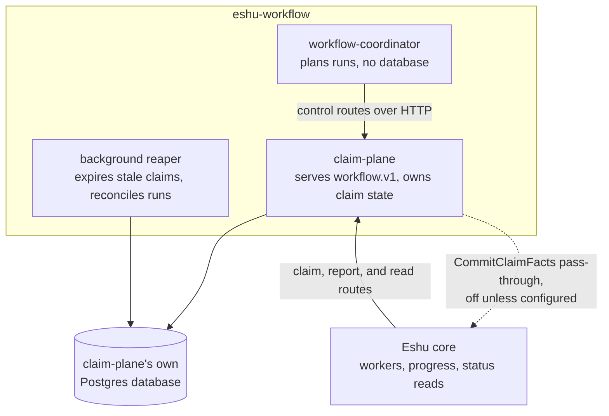
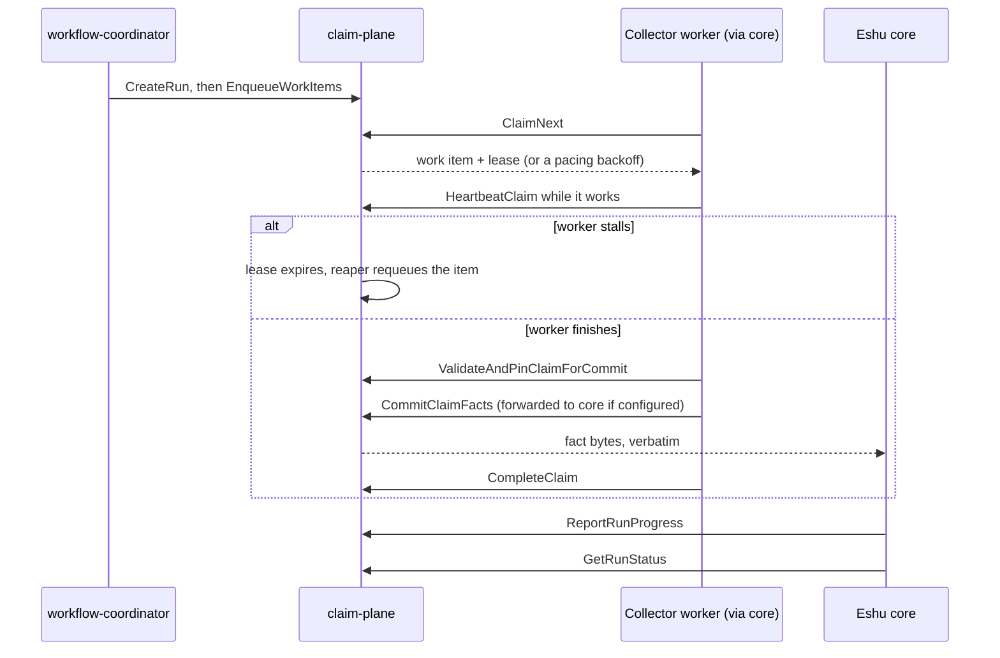

# Diagrams

Every diagram for eshu-workflow lives on this page. Other pages link
here instead of embedding their own copies. The repo
[README](../../README.md) keeps the first diagram only.

## Where the services sit

The coordinator decides what work should exist, the claim-plane
records it and leases it out item by item, and core reports progress
and reads status back. The dashed arrow stays off until you configure
a core URL, and while it's off that one route fails closed.

Text version: The workflow-coordinator calls the claim-plane's control
routes to create runs and enqueue items. The claim-plane stores state
in its own Postgres database. Collector workers (via core) claim,
heartbeat, and complete work against the claim-plane. Core reports
progress and reads run status. Optionally — off unless configured —
the claim-plane forwards fact commits back to core.

## Inside the repo

The claim-plane is the only process that touches the database,
including the background reaper.

Text version: Inside eshu-workflow, the coordinator (no database)
calls the claim-plane's control routes over HTTP. The claim-plane and
its background reaper (expires stale claims, reconciles runs) use the
claim-plane's own Postgres. Core uses the claim, report, and read
routes. The `CommitClaimFacts` pass-through back to core is off unless
configured.

## One claim, start to finish

A worker leases one item at a time and keeps the lease alive with
heartbeats. Before committing, it pins the claim so an expiring lease
can't kill it mid-commit.

Text version: (1) Coordinator calls `CreateRun`, then
`EnqueueWorkItems`. (2) Worker `ClaimNext` → work item + lease (or a
pacing backoff). (3) Worker heartbeats while working. (4a) If the
worker stalls, the lease expires and the reaper requeues the item.
(4b) If it finishes: `ValidateAndPinClaimForCommit`, then
`CommitClaimFacts` (forwarded verbatim to core if configured), then
`CompleteClaim`. (5) Core calls `ReportRunProgress` and `GetRunStatus`.
